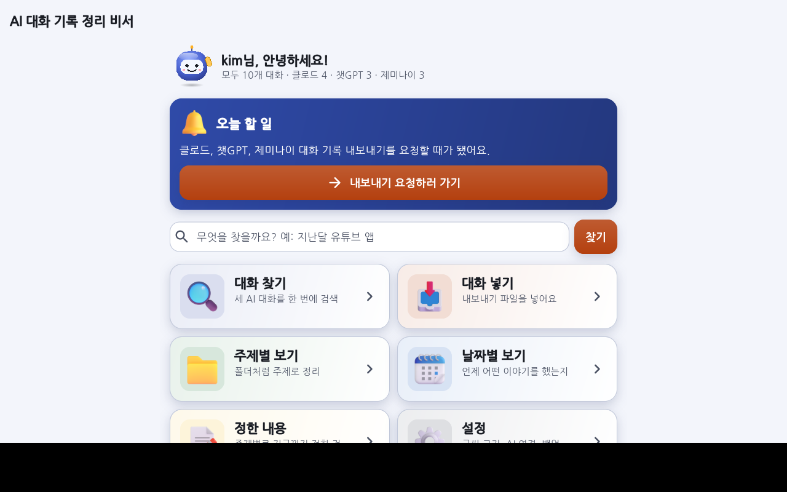
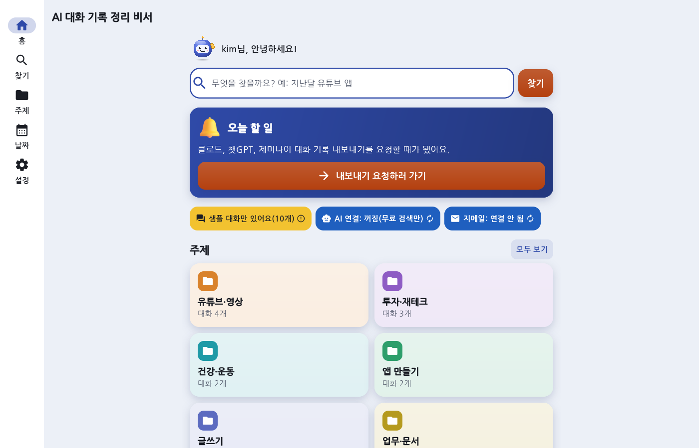
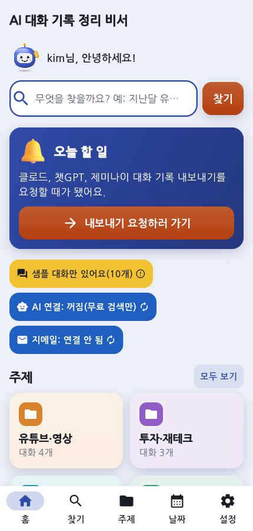
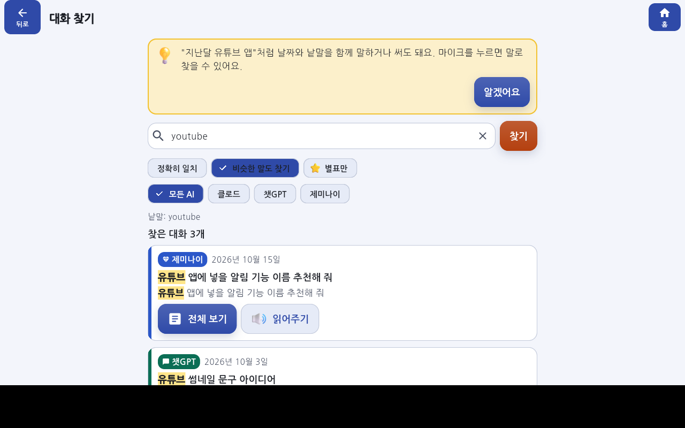
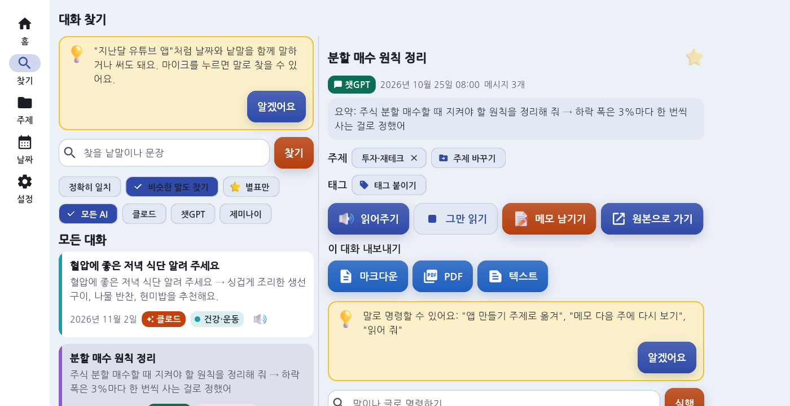
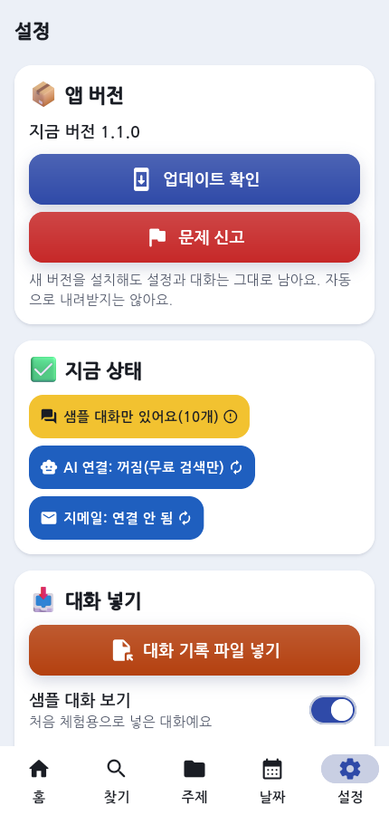

# 화면 전후 비교 (1.0.0 → 1.1.0)

| 화면 | 전(1.0.0) | 후(1.1.0) |
|---|---|---|
| 홈 |  | 넓은 화면  휴대폰 폭  |
| 검색 |  | 목록 + 내용 나란히  |
| 설정 | — |  |

## "가장 먼저 눈에 띄는 것이 가장 중요한 것인가" 점검

| 화면 | 가장 중요한 것 | 결과 |
|---|---|---|
| 홈 | 검색 | 예 — 맨 위, 화면 폭 전체, 높이 68px, 파란 굵은 테두리. 자동 테스트가 위치·크기 확인 |
| 홈 | 지금 할 일 하나 | 예 — 검색창 바로 아래 유일한 진한 색 카드 |
| 홈 | 주제 | 예 — 주제마다 다른 색 타일(2열), 같은 크기 상자 3개 이상 나란히 없음 |
| 검색 | 찾은 개수와 찾은 낱말 | 예 — 개수는 큰 숫자, 낱말은 노란 형광펜 |
| 대화 카드 | 제목 | 예 — 굵은 제목 1줄 → 요약 2줄 → 날짜·AI 배지 순서, 왼쪽에 주제 색 띠 |
| 설정 | 업데이트·문제 신고 | 예 — 맨 위 카드. 위험 동작은 맨 아래 빨강 카드 |

1.0.0에서 문제였던 점(모든 상자가 같은 모양·같은 크기, 얇은 테두리, 어두운 화면에서 카드와 바탕이 구분 안 됨)은 채운 카드 + 부드러운 그림자, 주제 색, 크기 차이로 바꿨습니다.

## 자동 디자인 검사
- 22개 화면 × 창 크기 3가지(360×640, 1280×800, 1600×900) × 밝게·어둡게·고대비, 가장 큰 글씨 → 잘림·겹침 없음
- 대비 4.5:1 이상: 기본 4가지 + 색 테마 5가지 × 밝게·어둡게
- 움직임 줄이기, 버튼 최소 크기, 글씨 크기 즉시 반영
